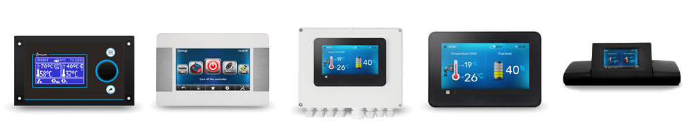
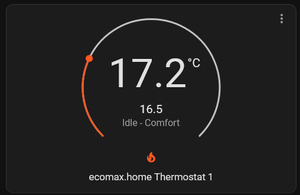

# Plum ecoMAX for Home Assistant

[](https://codecov.io/gh/denpamusic/homeassistant-plum-ecomax)
[](https://www.home-assistant.io/integrations/marketplace)
[](https://guidelines.denpa.pro/stability#release-candidate)
[](https://github.com/astral-sh/ruff)

Home Assistant integration for [Plum Sp. z o.o.](https://www.plum.pl/) ecoMAX boiler controllers and ecoSTER thermostats over RS-485 via [PyPlumIO](https://github.com/denpamusic/PyPlumIO)—direct local communication with no cloud or `ecoNET 300` module required.



> [!NOTE]
> Looking for `ecoNET 300` cloud/LAN support instead of a direct RS-485 bridge? Use **Patryk B / jontofront's** [ecoNET 300 integration](https://github.com/jontofront/ecoNET-300-Home-Assistant-Integration), which targets Plum's `ecoNET 300` module directly.

## Supported Controllers

Confirmed working controller models and tested firmware versions (support may vary across firmware revisions; other Plum ecoMAX models using the same RS-485 protocol and connected `ecoSTER` thermostats may also work):

| Model | Tested Firmware |
|---|---|
| `ecoMAX 350P2-ZF` | `1.13.5.Z1` |
| `ecoMAX 810P-L TOUCH` | `4.40.18.N0` |
| `ecoMAX 850i` | `109.10.129.P1` |
| `ecoMAX 850P2-C` | `6.10.32.K1`, `6.10.36.K1` |
| `ecoMAX 860D3-HB` | `3.34.45.K1` |
| `ecoMAX 860P4-NM TOUCH` | — |
| `ecoMAX 860P6-O` | — |
| `ecoMAX 920P1-K` | `18.11.58.K1` |
| `ecoMAX 920P1-O` | `12.11.71.P1` |
| `ecoMAXX 800R3` | `3.40.24.E1` |

---

## 1. Hardware Bridge & Bus Wiring

Wire an RS-485 bridge directly to the ecoMAX controller's RS-485 terminal block (`D+`, `D-`, optional `GND`) using either a local USB-to-RS-485 adapter or a network RS-485-to-TCP bridge:


| Adapter / Bridge Pin | ecoMAX Terminal | Notes |
|---:|:---|:---|
| `A` | `D+` | Differential data positive |
| `B` | `D-` | Differential data negative |
| `GND` | `GND` | Optional common reference |

> [!CAUTION]
> Power down the ecoMAX controller before opening its enclosure or wiring the RS-485 terminal block. Keep low-voltage RS-485 twisted-pair wiring physically separated from 230 V mains conductors. If no frames arrive after setup, swap `A` and `B`—RS-485 transceivers tolerate reversed polarity without damage.

### Transport Specifications

- **Network (TCP):** `socket://<host>:<port>`, default port **`8899`**. Works with RS-485-to-Ethernet/Wi-Fi bridges such as **Elfin-EW11** or **USR-TCP232** configured as a transparent TCP server (`115200 8N1`). Home Assistant sets the controller device's configuration link to `http://<host>` for quick bridge access.
- **Serial (USB):** direct serial device path (for example `/dev/ttyUSB0` or `/dev/serial/by-id/...`). Default baudrate is **`115200`**; supported baudrates are `9600`, `14400`, `19200`, `38400`, `57600`, and `115200`. When running Home Assistant in a container, pass the USB serial device into the container.

---

## 2. Install & Connect

### Home Assistant Marketplace

Install directly from the built-in [Home Assistant Marketplace](https://hacs.xyz/docs/marketplace/) (Home Assistant `2026.11+`, formerly HACS):

1. Open **Settings → Marketplace**, search for **Plum ecoMAX**, and install the integration. Or use the direct redirect button below (which automatically redirects to Marketplace):

   [](https://my.home-assistant.io/redirect/hacs_repository/?owner=denpamusic&repository=homeassistant-plum-ecomax&category=integration)

2. Restart Home Assistant.

3. Go to **Settings → Devices & services → Add integration**, search for **Plum ecoMAX**, and select **Connect via network (TCP)** or **Connect via serial (RS-485)**.

<details>
<summary>Manual installation (without Marketplace)</summary>

1. Clone the repository:

   ```sh
   git clone https://github.com/denpamusic/homeassistant-plum-ecomax
   ```

2. Copy `custom_components/plum_ecomax` into your Home Assistant `<config>/custom_components/` directory:

   ```sh
   cp -r ./homeassistant-plum-ecomax/custom_components/plum_ecomax ~/.homeassistant/custom_components/
   ```

3. Restart Home Assistant, then add **Plum ecoMAX** from **Settings → Devices & services → Add integration**.

</details>

### Startup & Availability Behavior


- **Non-blocking reactive startup:** Entry setup connects to the RS-485 bus and waits only for device identification and the initial `sensors` frame (`15 s` timeout). Built-in entities and detected sub-devices (`mixers`/`circuits`, `thermostats`) register reactively as their backing keys arrive in subsequent frames. Unsupported built-in entities are never created on fresh installs.
- **Disconnect & offline availability:** All entities except **Connection status** and **Total fuel burned** switch to `unavailable` whenever the RS-485 connection drops. This includes `climate` (ecoSTER thermostat) and `water_heater` entities, which also start `unavailable` until their first data keys arrive from the controller.
- **Database noise reduction:** Temperature sensors apply a **`0.1 °C`** deadband filter throttled to `10 s` updates to keep the Home Assistant recorder database compact.

---

## 3. Power-User Extensibility (`Configure` Menu)

### Adding Custom Entities

Every Plum firmware exposes model-specific keys and raw regulator registers beyond the built-in entity set.

1. Open **Settings → Devices & services → Plum ecoMAX → Configure** and choose **Add a new entity** (or **Edit an entity** / **Remove an entity**).
2. Select a **Source device**:
   - `ecomax` (*Common*) — decoded keys on the main controller
   - `regdata` (*Extended*) — raw numeric register IDs under `regdata`
   - `mixer_<index>` (*Mixer N*) — keys on a detected mixer/circuit
   - `thermostat_<index>` (*Thermostat N*) — keys on a detected ecoSTER thermostat
3. Select an **Entity type**: `sensor`, `binary_sensor`, `number`, or `switch` (`regdata` sources support read-only `sensor` and `binary_sensor` entities).
4. Pick a **Key** directly from the dropdown—the **Add a new entity** menu automatically lists every available, unconfigured key or numeric `regdata` ID for that source and entity type along with its live value—and configure the entity options:
   - `unit_of_measurement` (`sensor`, `number`)
   - `device_class` (`sensor`, `binary_sensor`, `number`)
   - `state_class` (`sensor`)
   - `mode` (`auto`, `box`, or `slider` for `number`)
   - `update_interval` (`10`–`60` s, default `10` s for `sensor`)
   - `step` (automatically populated from the controller's parameter metadata for `number` entities)

> [!TIP]
> Custom entities on `ecomax`, `mixer_*`, `thermostat_*`, and `regdata` register immediately on reload. A custom `regdata` entity remains `available` only while the RS-485 link is up and its numeric register ID is present in incoming `regdata` frames.

### Rediscovering Sub-Devices

If you wire an ecoSTER thermostat, add a mixer/circuit, or connect an indirect water heater temperature sensor after initial setup, open **Configure → Rediscover connected devices**. Home Assistant re-scans connected sub-devices and reloads the integration entry.

---

## 4. Automation & Control Recipes



### Boiler Alert Notifications (`plum_ecomax_alert`)

The integration emits `plum_ecomax_alert` on Home Assistant's event bus whenever an alert starts or clears, and automatically formats matching entries in the **Home Assistant Logbook**. Event payload fields:

- `name` — Config entry name
- `device_id` — Home Assistant device ID
- `code` — Alert code reported by the controller
- `from` — Start timestamp (`YYYY-MM-DD HH:MM:SS`)
- `to` — End timestamp (`YYYY-MM-DD HH:MM:SS`, present only after the alert clears)

```yaml
alias: Plum ecoMAX alert notification
triggers:
  - trigger: event
    event_type: plum_ecomax_alert
actions:
  - action: persistent_notification.create
    data:
      title: "Boiler Alert ({{ trigger.event.data.name }})"
      message: >
        Code {{ trigger.event.data.code }} —
        
          cleared at {{ trigger.event.data.to }} (started {{ trigger.event.data.from }}).
        
          active since {{ trigger.event.data.from }}.
        
```

### Reading & Writing Raw Parameters

Use `plum_ecomax.get_parameter` and `plum_ecomax.set_parameter` to inspect bounds or adjust any writable parameter exposed on the controller, mixer/circuit, or thermostat device (discoverable in Diagnostics).

```yaml
alias: Inspect and raise boiler target temperature
sequence:
  - action: plum_ecomax.get_parameter
    data:
      device_id: "0123456789abcdef0123456789abcdef"
      name: heating_target_temp
    response_variable: param
  - if:
      - condition: template
        value_template: "{{ param.value < param.max_value }}"
    then:
      - action: plum_ecomax.set_parameter
        data:
          device_id: "0123456789abcdef0123456789abcdef"
          name: heating_target_temp
          value: "65"
        response_variable: updated
```

### Automating Boiler & Circulation Schedules

Read or update controller schedules for any of the four supported schedule types: `heating`, `water_heater`, `circulation_pump`, and `boiler_work`.

```yaml
alias: Extend circulation pump schedule when working from home
triggers:
  - trigger: state
    entity_id: input_boolean.work_from_home
    to: "on"
actions:
  - action: plum_ecomax.set_schedule
    data:
      device_id: "0123456789abcdef0123456789abcdef"
      type: circulation_pump
      weekdays:
        - monday
        - tuesday
        - wednesday
        - thursday
        - friday
      preset: day
      start: "06:00:00"
      end: "22:00:00"
  - action: plum_ecomax.get_schedule
    data:
      device_id: "0123456789abcdef0123456789abcdef"
      type: circulation_pump
      weekdays:
        - monday
    response_variable: current_schedule
```

### Calibrating & Resetting the Fuel Meter

`Total fuel burned` tracks fuel consumption while Home Assistant runs and restores its state across restarts. Calibrate it after a hopper refill or reset it at the start of a heating season:

```yaml
alias: Calibrate fuel meter after refill
sequence:
  - action: plum_ecomax.calibrate_meter
    target:
      entity_id: sensor.ecomax_total_fuel_burned
    data:
      value: 250.0
```

```yaml
alias: Reset seasonal fuel meter
sequence:
  - action: plum_ecomax.reset_meter
    target:
      entity_id: sensor.ecomax_total_fuel_burned
```

---

## 5. Reference Catalog

Available entities depend on your controller model, firmware, and connected modules. Unsupported built-in entities are omitted automatically on fresh setups.

**Legend:**

- <kbd>p</kbd> — ecoMAX pellet boiler controller (e.g., ecoMAX 850p)
- <kbd>i</kbd> — ecoMAX installation controller (e.g., ecoMAX 850i)

<details>
<summary><b>Controller entities</b> (sensors, binary sensors, selects, switches, numbers, diagnostics)</summary>

### Sensors

- Heating temperature (`°C`)
- Water heater temperature (`°C`)
- Outside temperature (`°C`)
- Heating target temperature (`°C`)
- Water heater target temperature (`°C`)
- State (`off`, `stabilization`, `kindling`, `heating`, `paused`, `idle`, `standby`, `burning_off`, `alert`, `unknown`; attribute: `numeric_state`)
- Oxygen level (`%`) — requires `ecoLAMBDA` module
- Boiler power (`kW`) <kbd>p</kbd>
- Fuel level (`%`) <kbd>p</kbd>
- Fuel consumption (`kg/h`) <kbd>p</kbd>
- Total fuel burned (`kg`) <kbd>p</kbd> — meter entity (`always_available`; counts fuel burned while Home Assistant runs; attribute: `burned_since_last_update` in g)
- Boiler load (`%`) <kbd>p</kbd>
- Fan power (`%`) <kbd>p</kbd>
- Flame intensity (`%`) <kbd>p</kbd>
- Feeder temperature (`°C`) <kbd>p</kbd>
- Exhaust temperature (`°C`) <kbd>p</kbd>
- Return temperature (`°C`) <kbd>p</kbd>
- Lower buffer temperature (`°C`) <kbd>p</kbd>
- Upper buffer temperature (`°C`) <kbd>p</kbd>
- Lower solar temperature (`°C`) <kbd>i</kbd>
- Upper solar temperature (`°C`) <kbd>i</kbd>
- Fireplace temperature (`°C`) <kbd>i</kbd>

### Binary sensors

- Heating pump
- Water heater pump
- Circulation pump
- Fan <kbd>p</kbd>
- Exhaust fan <kbd>p</kbd>
- Feeder <kbd>p</kbd> — disabled by default
- Lighter <kbd>p</kbd>
- Solar pump <kbd>i</kbd>
- Fireplace pump <kbd>i</kbd>

### Selects

- Summer mode (`winter`, `summer`, `auto`)

### Switches

- Controller switch
- Water heater disinfection switch
- Water heater pump switch
- Weather control switch <kbd>p</kbd>
- Fuzzy logic switch <kbd>p</kbd>
- Heating schedule switch <kbd>p</kbd>
- Water heater schedule switch <kbd>p</kbd>

### Numbers

- Target heating temperature (`°C`) <kbd>p</kbd>
- Minimum heating temperature (`°C`) <kbd>p</kbd>
- Maximum heating temperature (`°C`) <kbd>p</kbd>
- Grate mode temperature (`°C`) <kbd>p</kbd>
- Fuzzy logic minimum power (`%`) <kbd>p</kbd>
- Fuzzy logic maximum power (`%`) <kbd>p</kbd>
- Fuel calorific value (`kWh/kg`) <kbd>p</kbd>

### Diagnostics

- Alert (`binary_sensor`, `problem`)
- Connection status (`binary_sensor`, `connectivity`, `always_available`)
- Service password (`sensor`)
- Connected modules (`sensor`, count + attributes for `module_a`, `module_b`, `module_c`, `panel`, `ecoster`, `ecolambda` software versions)

</details>

<details>
<summary><b>Water heater, Thermostats &amp; Mixers / Circuits</b></summary>

### Water heater

Provided as a Home Assistant `water_heater` entity (**Indirect water heater**) when a water heater temperature sensor is detected (`1 °C` target step, target temperature + operation mode).

| Home Assistant State | ecoMAX Mode |
|---:|:---|
| `Performance` | Priority Mode |
| `Eco` | Non-Priority Mode |
| `Off` | Off |

### Thermostats (`ecoSTER`)

Each connected ecoSTER thermostat is exposed as a Home Assistant `climate` entity (`heat` HVAC mode, `heating`/`idle` action, `0.1 °C` target temperature step) with presets: `schedule`, `eco`, `comfort`, `away`, `airing`, `party`, `holidays`, and `antifreeze`.

### Mixers / Circuits

Exposed as **Mixer N** on <kbd>p</kbd> controllers and **Circuit N** on <kbd>i</kbd> controllers:

- **Sensors:**
  - Mixer / Circuit temperature (`°C`)
  - Mixer / Circuit target temperature (`°C`)
- **Binary sensors:**
  - Mixer / Circuit pump
- **Selects:**
  - Work mode (`off`, `heating`, `heated_floor`, `pump_only`) <kbd>p</kbd>
  - Work mode (`off`, `heating`, `heated_floor`) <kbd>i</kbd> — circuits 2 & 3 only
- **Switches:**
  - Enable in summer mode
  - Weather control switch <kbd>p</kbd>
  - Disable pump on thermostat <kbd>p</kbd>
  - Enable circuit <kbd>i</kbd> — circuit 1 only
- **Numbers:**
  - Target mixer temperature (`°C`) <kbd>p</kbd>
  - Minimum mixer temperature (`°C`) <kbd>p</kbd>
  - Maximum mixer temperature (`°C`) <kbd>p</kbd>
  - Target circuit temperature (`°C`) <kbd>i</kbd>
  - Minimum circuit temperature (`°C`) <kbd>i</kbd> — circuits 2 & 3 only
  - Maximum circuit temperature (`°C`) <kbd>i</kbd> — circuits 2 & 3 only
  - Day target circuit temperature (`°C`) <kbd>i</kbd> — circuits 2 & 3 only
  - Night target circuit temperature (`°C`) <kbd>i</kbd> — circuits 2 & 3 only

</details>

<details>
<summary><b>Actions &amp; fields schema</b></summary>

| Action | Target / `device_id` | Fields | Response Keys |
|---|---|---|---|
| `plum_ecomax.get_parameter` | `device_id` (controller, mixer/circuit, thermostat) | `device_id` (required), `name` (required, string) | `name`, `value`, `min_value`, `max_value`, optional `step`, `unit_of_measurement`, `device` (`type`, `index`), `product` (`model`, `uid`) |
| `plum_ecomax.set_parameter` | `device_id` (controller, mixer/circuit, thermostat) | `device_id` (required), `name` (required, string), `value` (required: positive float or `"on"` / `"off"`) | Optional (same structure as `get_parameter`) |
| `plum_ecomax.get_schedule` | `device_id` (controller) | `device_id` (required), `type` (`heating`, `water_heater`, `circulation_pump`, `boiler_work`), `weekdays` (list of `monday`–`sunday`) | `name`, `schedule` (`{weekday: {"HH:MM": "day" \| "night"}}`), optional `product` (`model`, `uid`) |
| `plum_ecomax.set_schedule` | `device_id` (controller) | `device_id` (required), `type` (`heating`, `water_heater`, `circulation_pump`, `boiler_work`), `weekdays` (list of `monday`–`sunday`), `preset` (`day`, `night`), `start` (`HH:MM:SS`, default `00:00:00`), `end` (`HH:MM:SS`, default `00:00:00`) | None |
| `plum_ecomax.calibrate_meter` | Entity target (`device_class: plum_ecomax__meter`) | `value` (required, positive float) | None |
| `plum_ecomax.reset_meter` | Entity target (`device_class: plum_ecomax__meter`) | None | None |

</details>

---

## License

This project is distributed under the [MIT License](LICENSE).
